# Ovid2

> **🚧 Under active development.** Ovid2 is alpha software.
> Interfaces, configuration shapes, and on-disk formats may change without
> notice. Do not point production workloads at it without reviewing the
> [status](#status) section first.

**Ovid2** is a healthcare-data **ETL engine**. It ingests raw source data and
transforms it into standardized common-data-model shapes —
[PCORnet CDM v7.0](https://pcornet.org/data-driven-common-model/) and
[OMOP CDM 5.3](https://ohdsi.github.io/CommonDataModel/) — and writes the
result to a configurable output. It also runs the **PCORnet EDC data-quality
checks** against any PCORnet database.

Its defining design goal is **isolation between the three axes of an ETL
job — storage, compute, and algorithms** — so each can change without
touching the others:

- **Storage** — a pluggable *driver* layer (disc, S3, Azure Blob, Snowflake,
  Microsoft Access, GCS, Databricks, Postgres, MSSQL).
- **Compute** — a pluggable *engine* layer (PySpark, Databricks, Snowpark),
  decoupled from storage by an `EngineStager` (**engine/storage
  orthogonality**), so any engine can read/write any driver.
- **Algorithms** — declarative formatters, mappers, fixer chains, and a
  general-purpose transforms library that never import a specific CDM or
  engine (**CDM/ETL independence**).

Around that engine sits an event-driven display layer, a pip/pipx-installable
package, XDG-compliant paths, a **web control panel + JSON API**, an
**MCP server** for AI agents, an optional **LLM assistant**, and a systemd
deployment story. Everything is **lazy end-to-end**: nothing materializes
until the single terminal write at the end of a run.

**Agent Ovid** is a specialized LLM **harness** for driving Ovid2. It is the
untrusted planner (the MCP server, `src/ovid2/mcp/`, and the in-panel
assistant): it may only *read* through a typed HTTP capability API and
*propose* actions a human approves; it never touches a credential, storage
handle, or pipeline module. The trusted API authorizes, audits, and gates
every request; only the executor tier dereferences secrets. See
[Architecture at a glance](#architecture-at-a-glance).

## Status

This repository ships the complete engine, the web control panel, the MCP
server, the LLM assistant, two generic pipeline packages
(`example_pcornet` and `pcornet_to_omop`), and the PCORnet EDC check
library. Site-specific pipeline packages are maintained separately by each
deploying organization (see [Pipelines](#pipelines-adapters-mappers--fixes)).

| Area | State |
| --- | --- |
| Engine, drivers, engines, formatters, mappers, fixers, transforms | Feature-complete, alpha |
| Web control panel + JSON API + MCP server | Feature-complete, alpha |
| Web authentication (OIDC SSO + RBAC) | Implemented, **off by default** |
| LLM assistant (general + System 1) | Implemented, **off until you configure a model** |
| Native drivers | `disc`, `s3`, `azure_blob`, `snowflake`, `access`; the rest run through a legacy adapter |
| Version | `0.1.0` (pre-1.0; no stability guarantees) |

## Table of contents

- [Quick start](#quick-start)
- [Concepts & glossary](#concepts--glossary)
- [Architecture at a glance](#architecture-at-a-glance)
- [The ETL workflow (five stages)](#the-etl-workflow-five-stages)
- [Design choices](#design-choices)
- [Subsystems](#subsystems)
- [Tech stack](#tech-stack)
- [Repository layout](#repository-layout)
- [Requirements](#requirements)
- [Installation](#installation)
- [Running Ovid2](#running-ovid2)
- [Pipelines, adapters, mappers & fixes](#pipelines-adapters-mappers--fixes)
- [Data health & EDC checks](#data-health--edc-checks)
- [Web control panel & MCP](#web-control-panel--mcp)
- [LLM assistant](#llm-assistant)
- [Scheduling & the worker](#scheduling--the-worker)
- [Testing](#testing)
- [Documentation](#documentation)
- [Contributing & security](#contributing--security)
- [License](#license)

## Quick start

**No Docker?** The fastest way to see Ovid2 work is the Docker-less local
run: `ovid2 etl --local` runs the whole pipeline in-process on a `local[*]`
Spark session, disc → disc. It needs only the `[spark]` extra plus a JDK.
Follow [`docs/quickstart-local.md`](docs/quickstart-local.md).

The full, containerised path:

```bash
# 1. Install the console script (developer or operator)
pipx install .                 # or: uv tool install .

# 2. Bootstrap the XDG config tree and diagnose the environment
ovid2 init
ovid2 doctor

# 3. Build the Spark image (one-time)
ovid2 image build

# 4. Run one pipeline for one batch (each address is the exact folder
#    read / written; --overwrite to replace an occupied output)
ovid2 etl \
    --input_address  disc_input \
    --output_address disc_output \
    --pipeline example_pcornet --batch_id inbox/2024_01 \
    --tables all --transformations all

# 5. Watch it live (in another terminal)
ovid2 watch
```

Prefer a UI? `ovid2 web` serves a control panel at `http://127.0.0.1:8090`
where you can submit, monitor, and schedule runs (start `ovid2 web-worker`
alongside it to execute queued jobs).

## Concepts & glossary

Ovid2 has grown several nouns. This is the disambiguation table — skim it
once and the rest of the doc reads cleanly.

| Term | What it is |
|---|---|
| **Pipeline** | A data-source package under `pipelines/ovid2_pipelines/<name>/` — its formatter specs, dictionaries, fixer chain, and settings. |
| **Pipeline config / kind** | A persisted, schedulable job template. Its **kind** (`etl`, `analysis`, `dq_checks`, `health`, `copy`, `move`) comes from the run-kind registry (`src/ovid2/run_kinds.py`). |
| **CDM** | Common Data Model — the *target shape* (`pcornet_7_0`, `omop_5_3`). Authored as a YAML tree under `resources/cdms/`; the ETL engine never imports a CDM module (P10). |
| **Formatter (spec)** | A YAML/dict declaration of how to build one CDM table from raw sources, via a framework **adapter**. |
| **Mapper (op)** | A declarative value-translation step (`translate_by_dict`, `hash_id`, …) applied during the map stage. |
| **Fixer** | A reusable post-map repair plugin (e.g. `future_date_to_null`) opted into via a pipeline's fixer chain. |
| **Transform** | A CDM-agnostic DataFrame op (`trim`, `dedup`, `unpivot`, `random_sample`, …) composed into named, reusable chains. |
| **Health check** | A declarative data-quality check (PCORnet EDC `DC x.yy` or an Ovid2-native panel) grouped into report-cycle packages. |
| **Connection** | *How* to reach a system (credential-heavy, reusable) — e.g. a Snowflake account, an S3 bucket. |
| **Address** | *Where* in a connection — the **exact** folder / bucket prefix / `DATABASE/SCHEMA` the data is read from or written to (nothing is appended to it). |
| **Engine** | The *compute* backend: `pyspark`, `databricks_spark`, or `snowpark`. |
| **Driver** | The *storage* backend: `disc`, `s3`, `azure_blob`, `snowflake`, `access`, `gcs`, `databricks`, `postgres`, `mssql`. |
| **Stager** | The seam that moves data between an engine and a driver (Spark = pass-through; Snowpark = per-backend staging strategy). |
| **Instance id** | `YYYYMMDD-HHMMSS-<6hex>` — minted once per run and threaded end-to-end; the single correlation key across every tier and the event log. |
| **ODS (Data Space)** | Every storage account as a tree of plain directories, `/<account>/<path…>`; a folder's full path is the batch id of a run reading it. |
| **Draft job** | A fully-specified run that is *not* queued until a human presses ▶ (how the assistant hands work to you). |

## Architecture at a glance

Ovid2 enforces a **three-tier trust split** (untrusted planner → trusted API
→ executor), plus a
Dockerized Spark cluster that does the heavy lifting. Each diagram below is a
rendered image (source under [`docs/diagrams/`](docs/diagrams); expand
*Mermaid source* to edit) followed by a one-paragraph description.

> One correlation key rules them all: the **instance id** is minted when a run
> is submitted and flows verbatim into the `web_jobs` row → the
> `OVID2_INSTANCE_ID` env var → the container name (`ovid2-driver-<id>`) →
> the event log (`events-<id>.jsonl`) → the live web view. If you can see the
> instance id, you can trace the run everywhere.

### 1. System component map

The big picture: who lives where, and who is allowed to talk to whom.

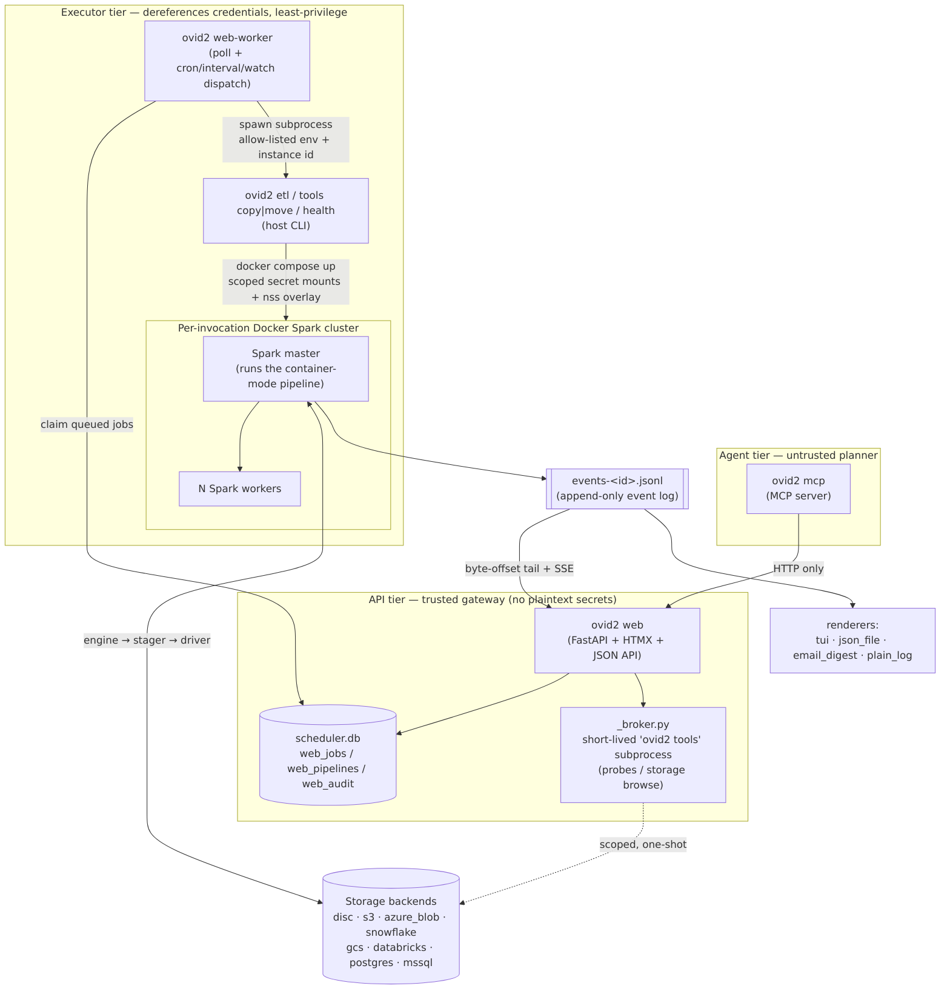

<details>
<summary>Mermaid source (editable) — also available as <a href="docs/diagrams/01-component-map.svg">SVG</a></summary>

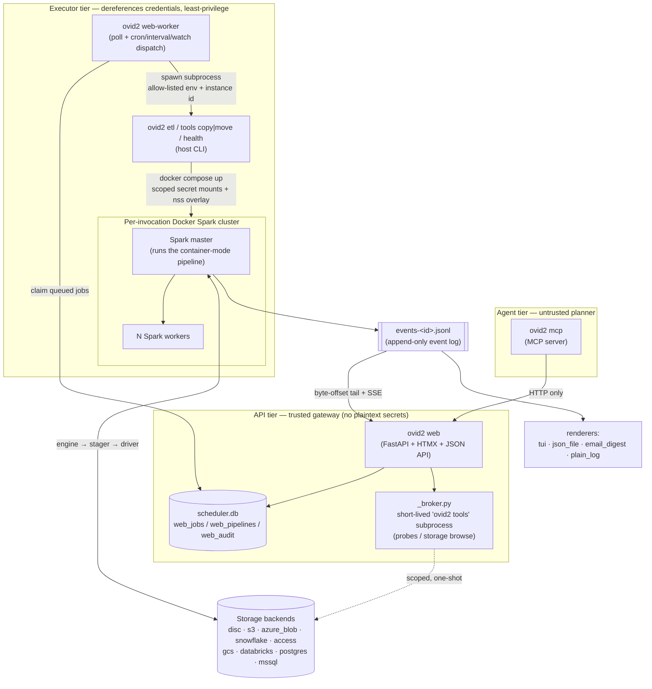

</details>

- **Agent tier** (`src/ovid2/mcp/`) speaks *only* the typed HTTP API — it
  imports no secret, driver, connection, or pipeline module.
- **API tier** (`src/ovid2/web/`) authorizes, audits, and gates, but never
  resolves a plaintext secret in a request handler. Credential-bearing probes
  and directory listings go through a short-lived `ovid2 tools …` subprocess
  (`_broker.py`).
- **Executor tier** (`cli` / `core` / `drivers`) is the only place that
  dereferences credentials. The worker runs with an allow-listed environment;
  the container gets only the secret files this run actually references.
- The legacy in-process `scheduler/service.py` is **parked for rollback** —
  the live scheduling path is the web-worker (see diagram 3).

### 2. Submit → execute (sequence)

What happens between clicking "submit" and rows landing in the warehouse.

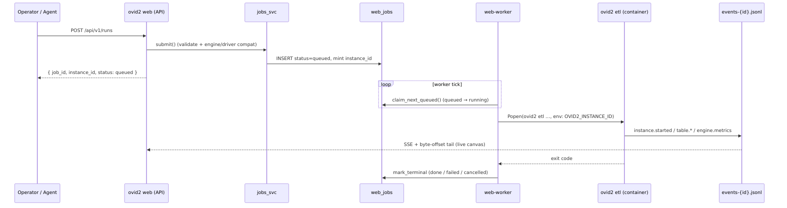

<details>
<summary>Mermaid source (editable) — also available as <a href="docs/diagrams/02-submit-sequence.svg">SVG</a></summary>

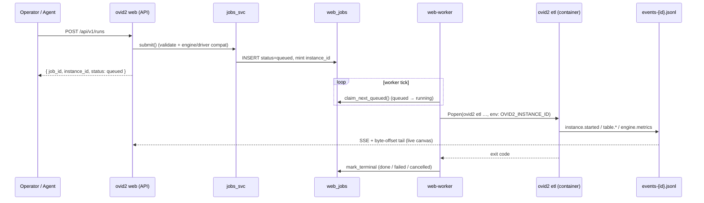

</details>

State machine: `queued →(claim) running →(exit 0) done`; `→(exit≠0) failed`;
`→(SIGTERM) cancelled`; a worker crash re-fails orphaned `running` rows on the
next start.

### 3. What triggers a run

Four independent entry points, one queue.

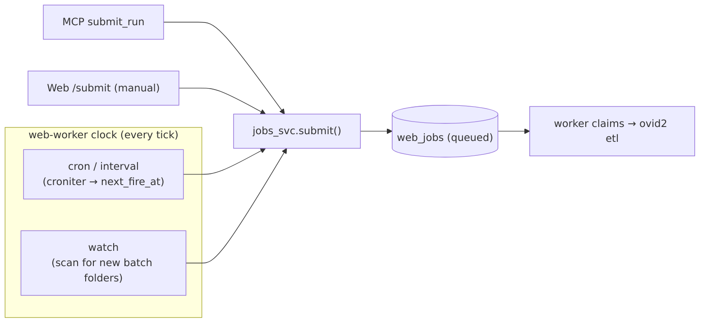

<details>
<summary>Mermaid source (editable) — also available as <a href="docs/diagrams/03-triggers.svg">SVG</a></summary>

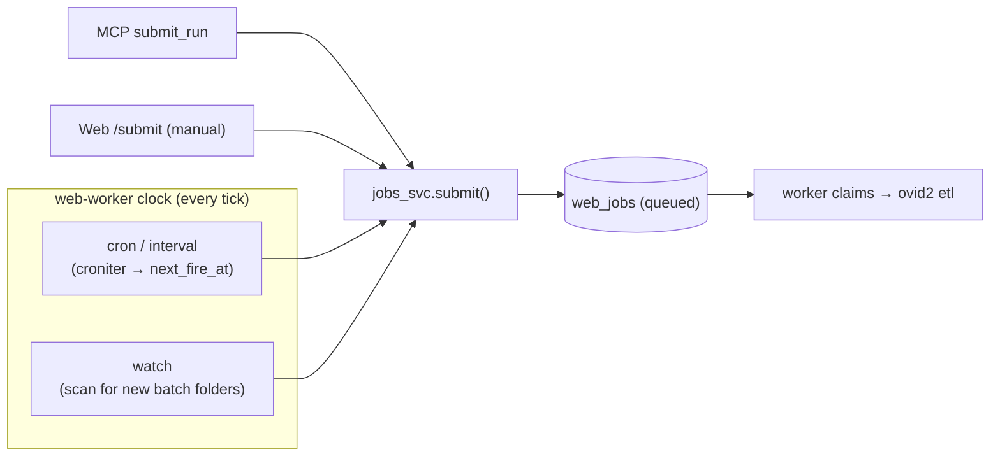

</details>

`cron`/`interval` fire on the worker's clock (evaluated with `croniter`);
`watch` fires when the worker sees a new `<pipeline>/<batch>` folder appear.
All four converge on `jobs_svc.submit()` and the same queue.

### 4. Host mode vs container mode + isolation

`ovid2 etl` behaves differently depending on whether it is already inside the
Spark image (detected via `/.dockerenv`).

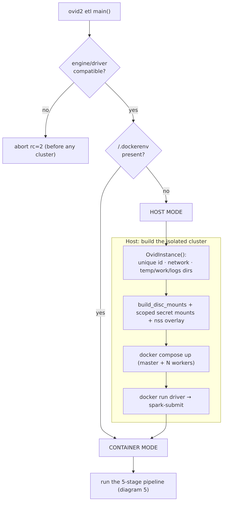

<details>
<summary>Mermaid source (editable) — also available as <a href="docs/diagrams/04-host-container.svg">SVG</a></summary>

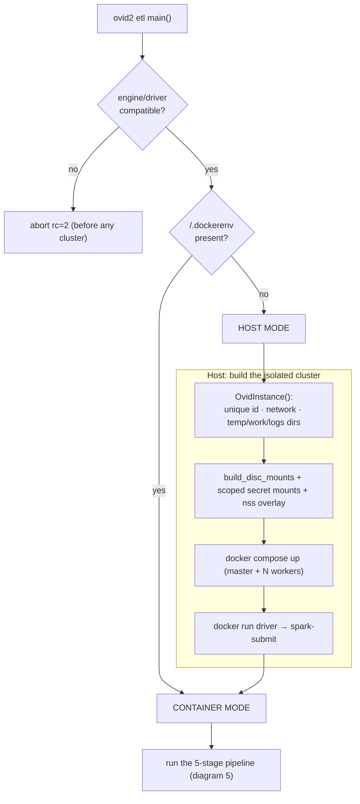

</details>

Every invocation gets its own instance id, compose file, Docker bridge
network, temp/work/logs directories, secret scope, and event-log path, so
concurrent runs never clobber each other. A per-container `nss-wrapper`
overlay lets the container run as your uid/gid while still reading the
mode-`0600` secret mounts.

### 5. The five-stage lazy pipeline

Inside the container, one Spark plan per table, one write per pipeline.

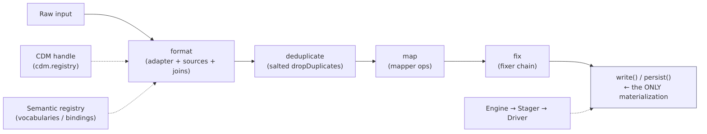

<details>
<summary>Mermaid source (editable) — also available as <a href="docs/diagrams/05-five-stage.svg">SVG</a></summary>

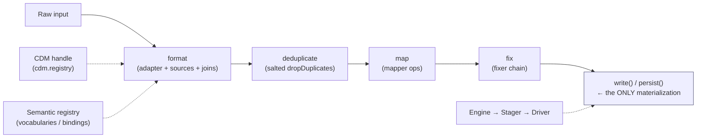

</details>

The whole plan is **lazy end-to-end** — nothing materializes until the
terminal `write()` (Spark) / `persist()` (staged engines like Snowpark). The
CDM handle and semantic registry feed the format stage without the engine
ever importing a CDM module. The engine→stager→driver seam is where compute
(PySpark/Snowpark) and storage (disc/s3/…) become orthogonal.

### 6. Event bus & live display

Pipeline code never prints — it emits typed events; everything else
subscribes.


<details>
<summary>Mermaid source (editable) — also available as <a href="docs/diagrams/06-event-bus.svg">SVG</a></summary>

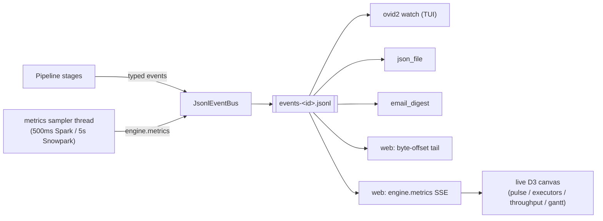

</details>

The JSONL log is append-only, mode `0600`, and bind-mounted at the same
absolute path inside and outside the container, so host renderers and the web
tier read exactly what the pipeline wrote. A daemon sampler thread emits cheap
`engine.metrics` heartbeats that drive the "cooking" live view.

## The ETL workflow (five stages)

The core pipeline is five stages, one Spark plan per table, one write per
pipeline:

```
┌─────────────┐    ┌─────────────┐    ┌───────────────┐    ┌─────────────┐    ┌─────────────┐    ┌─────────────┐
│  Raw Data   │───>│   Format    │───>│  Deduplicate  │───>│     Map     │───>│     Fix     │───>│   Upload    │
│  (Input)    │    │             │    │               │    │             │    │             │    │  (Output)   │
└─────────────┘    └─────────────┘    └───────────────┘    └─────────────┘    └─────────────┘    └─────────────┘
```

1. **Format** — apply the pipeline's declarative spec (adapter + sources +
   joins + projection) to produce a CDM-shaped DataFrame.
2. **Deduplicate** — remove exact-duplicate rows lazily via a salted
   `dropDuplicates` (skew-relief; see `DEDUP_SALT_BUCKETS`).
3. **Map** — apply the pipeline's mapper ops (`translate_by_dict`,
   `translate_by_concept`, `hash_id`, `case_map`, `regex_replace`, `literal`,
   `passthrough`, `apply_transforms`) to translate source values to standard
   vocabularies.
4. **Fix** — apply the pipeline's chain of common fixes plus any
   pipeline-specific fixes.
5. **Upload** — write to the output address (any of the nine drivers; disc
   for tests and local runs).

Beyond the five-stage ETL, Ovid2 also ships these run kinds / surfaces:

| Kind / surface | What it does |
|---|---|
| **`analysis`** | Reuse the pipeline with the analysis transformer chain (`monthly_counts`, `distinct_values`, `raw_distinct_values`). |
| **`dq_checks`** | PCORnet EDC data-characterization checks selected by **report cycle** (e.g. `dcq_v7_03`). |
| **`health`** | Data-health / EDC checks selected by cycle, part, or explicit check id; produces a browsable report. |
| **`copy` / `move`** | Driver-native one-shot table moves between any two addresses (no transformation; `--tables all` for self-describing sources such as Access). |
| **`tools raw_upload`** | Ship raw pipeline files to the output address as-is. |
| **`web` / `web-worker` / `mcp`** | The control panel, its dispatcher, and the agent server. |

Every kind is one `KindSpec` entry in the run-kind registry
(`src/ovid2/run_kinds.py`); the web panel, worker, and CLI all read it.

## Design choices

The invariants that shape the codebase. Each is a deliberate choice, most of
them enforced by a contract test.

| Choice | What it buys |
|---|---|
| **Declarative formatters** | Tables are built from YAML/dict specs picking a framework-level adapter; hand-written `custom` classes are the rare exception, not the rule. |
| **Lazy end-to-end** | No `.collect()`/`.toPandas()`/intermediate writes in the pipeline; nothing materializes until the single terminal write. Enforced by contract tests. |
| **Display isolation** | Pipeline code emits typed events on an EventBus; renderers subscribe. Pipeline modules never import `display/`. |
| **Pluggable compute** | Engines (PySpark / Databricks Connect / Snowpark) sit behind `EngineSession` / `EngineFunctions` protocols; only engine modules may import a compute SDK. |
| **Pluggable storage** | Nine peripherals behind one `Driver` protocol; an `EngineStager` keeps engine and storage orthogonal (any engine ↔ any driver). |
| **CDM/ETL independence** | The engine never imports a CDM module — table lists, keys, valuesets, and shared views live on a `CdmHandle` authored as YAML. |
| **Trust separation** | Untrusted agent (MCP / assistant) → trusted API (web) → executor (CLI/core/drivers); only the executor dereferences secrets. Destructive operations require human approval. |
| **Multiple control surfaces** | CLI **+** web control panel + JSON API **+** MCP server **+** in-panel LLM assistant, all over the same job model. |
| **XDG paths** | Config, secrets, runtime state, material, and data all resolve through XDG (with legacy paths honoured inside the Docker image). |
| **Installable & operable** | PEP 621 wheel, `pipx install .`, src-layout package + PEP 420 namespace pipelines, `ovid2 <cmd>` console script, systemd units. |
| **Enforced conventions** | `ruff`, `mypy --strict`, `pytest` markers, `pre-commit`, and a `tests/contract/` suite that fails the build on any invariant violation. |

## Subsystems

### Compute engines

Engines live in `src/ovid2/core/engines/` (concrete classes, the only place
allowed to `import pyspark` / `import snowflake.snowpark`) with a web-safe
config mirror at `src/ovid2/config/engines.py`. Registered types:
`pyspark`, `databricks_spark`, `snowpark`. The pipeline talks to
`EngineSession` / `EngineFunctions` protocols and routes storage through an
`EngineStager`, so the choice of engine is orthogonal to the choice of
storage backend. A plan-time compatibility gate refuses incompatible pairings
(e.g. Snowpark against a peripheral it cannot stage) before any cluster spins
up. Enforced by `tests/contract/test_no_pyspark_outside_engine.py` and
`test_engine_registry_complete.py`.

Snowpark staging strategies (Snowflake ↔ disc / s3 / azure_blob / databricks /
gcs) live under `src/ovid2/drivers/snowflake/staging/`.

### Drivers & connections

Every storage peripheral is a `Driver` (`src/ovid2/drivers/`) owning both the
control plane (credentials, probe, container requirements) and the data plane
(read/write). Nine types are registered in `drivers/registry.py::DRIVERS`:

| Native drivers | Legacy-adapter drivers |
|---|---|
| `disc`, `s3`, `azure_blob`, `snowflake`, `access` | `gcs`, `databricks`, `postgres`, `mssql` |

The four legacy types run through `LegacyDriverAdapter` today; native ports
land per type. **Connections** (`src/ovid2/connections/`) are the reusable
credential-bearing endpoints; **addresses** are cheap views onto them.
Connections and drivers are top-level packages (not under `core`) so the web
and MCP tiers can import them without violating the pipeline-import contract.

The **`access`** driver reads Microsoft Access `.accdb` / `.mdb` files through
UCanAccess (JDBC). The jars and a custom Spark JDBC dialect (which fixes
UCanAccess's double-quoted-identifier behaviour) are baked into the Docker
image; host-side table listing uses the optional `access` extra
(`JPype1`, `jaydebeapi`). Sources like Access are *self-describing*, so
`copy` / `move` accept `--tables all`.

### CDM registry

CDMs are authored as YAML trees under `src/ovid2/resources/cdms/<cdm>/`
(`cdm.yaml` + `tables/*.yaml` + `valuesets/*.yaml`). Registered handles:
`pcornet_7_0` (default), `omop_5_3`, plus three lightweight pipeline-family
handles (`ovid2_pipeline_veritas_v1`, `_nursing_v1`, `_tumor_v1`). Add a CDM by
dropping a YAML directory and a five-line handle module. The ETL engine never
imports a CDM module — everything flows through `ovid2.cdm.registry`.

### Semantic layer

Cross-CDM clinical vocabularies (OMOP CONCEPT, LOINC, SNOMED, ICD-10-CM,
ICD-9-CM, RxNorm, NDC) live under `src/ovid2/resources/semantic/`
(`vocabularies/*.yaml` + `bindings/<cdm>.yaml`) and self-register at import
time. They back the `semantic_join` formatter adapter and the
`translate_by_concept` mapper op. Extract a slice from the OMOP CONCEPT bundle
with `ovid2 tools import-vocabulary`.

### Transforms library

`src/ovid2/transforms/` is a CDM-agnostic, pipeline-type-free menu of
**32 lazy DataFrame ops** — formatting (`trim`, `to_upper`, `pad`,
`normalize_whitespace`, …), correction (`clamp`, `null_if`,
`standardize_null`, `coalesce_columns`, …), reshape (`pivot`, `unpivot`,
`explode`, `reduce`, …), and sampling (`random_sample`, `stratified_sample`,
`head_by_group`, …). Ops compose into named YAML chains (shared under
`resources/transforms/`, per-pipeline under `<pipeline>/transforms/`) and are
wired into the map stage via the `apply_transforms` mapper op. The catalogue
is browsable at `GET /api/v1/transforms` and via MCP. See
[`docs/transforms.md`](docs/transforms.md).

### Data Space (ODS)

Every storage account — disc, object store or warehouse — is a tree of plain
directories, `/<account>/<path…>` (`src/ovid2/dataspace/`). An address is the
exact location its data is read from / written to; a folder's complete path is
the batch id of a run that reads it. Browse it with
`ovid2 tools ods {ls,resolve,dimensions}` or the web *Data Space* page.

### Per-invocation isolation

Every `ovid2` invocation creates a unique instance id (`YYYYMMDD-HHMMSS-<6hex>`,
`core/isolation.py`) and scopes every shared resource to it: compose file,
bridge network, Spark temp/work/logs dirs, signal dir, and the event-log path.
A startup sweep removes orphaned instance files older than 6 hours.

### Display isolation

Pipeline code (`core/`, `transformations/`, `formatters/`, `mappers/`) must
not import from `display/`. It emits typed events; renderers subscribe.
Enforced by `tests/contract/test_display_isolation.py`.

### Declarative formatter engine

Every formatter is a YAML spec under
`pipelines/ovid2_pipelines/<pipeline>/formatters/<table>.yaml`, selecting a
framework-level adapter:

| Adapter | Purpose |
|---|---|
| `source_passthrough` | Rename / cast / literal columns from same-shaped sources |
| `semantic_join` | Join sources to a semantic vocabulary (superset of `omop_concept_join`) |
| `omop_concept_join` | Compatibility shim over `semantic_join` for OMOP CONCEPT joins |
| `union_of_specs` | Compose sub-specs (e.g. VITAL from BP + height + weight) |
| `custom` | Escape hatch — subclass `BaseFormatter` when YAML cannot express it |

(`pcornet_passthrough` remains registered as a **deprecated alias** for
`source_passthrough` so legacy YAMLs load.) Adding a per-pipeline adapter is
forbidden; adapters are framework-level. Spec schema:
`src/ovid2/resources/schemas/formatter_spec.v1.json`. Full reference:
[`docs/formatter-spec.md`](docs/formatter-spec.md).

## Tech stack

| Category | Technology |
|----------|------------|
| Language | Python — runs on 3.11+ (packaging floor); runtime image + dev target 3.14 (CI tests 3.11–3.14) |
| Big Data | Apache Spark 4.1 (PySpark, Scala 2.13) on `python:3.14-slim` + OpenJDK 21 (image); host-dev extra pins `pyspark>=4.1,<4.2` |
| Compute engines | PySpark, Databricks Connect, Snowpark |
| Containers | Docker + Docker Compose |
| Storage drivers | disc, s3, azure_blob, snowflake, access, gcs, databricks, postgres, mssql |
| Warehouse | Snowflake (RSA key-pair auth) is the most-exercised output path |
| Web / API | FastAPI + Jinja2 + HTMX + self-hosted D3 (no CDN) |
| Agents | MCP SDK (`ovid2 mcp`); OpenAI-compatible LLM endpoints for the assistant |
| Scheduling | `croniter` (cron/interval), watch-folder polling |
| Config validation | `pydantic` + `jsonschema` (spec + event schemas) |
| Build system | `hatchling` (PEP 621 in `pyproject.toml`) |
| Env manager | `uv` recommended (`pip` / `pipx` supported) |
| Encryption | PyCryptodome (SHA + XOR patient-ID cipher, ported from legacy) |
| Token matching | Datavant (external CLI, privacy-preserving linkage) |
| Systemd | Hardened units + logrotate + tmpfiles.d |

## Repository layout

```
ovid2/
  pyproject.toml            PEP 621 metadata, ruff/mypy/pytest config
  README.md                 This file
  CHANGELOG.md              Running change log
  CONTRIBUTING.md           How to contribute
  SECURITY.md               How to report a vulnerability
  .pre-commit-config.yaml   ruff, mypy, contract tests
  .github/                  CI workflow, issue + PR templates
  src/ovid2/                Python package (src-layout)
    cli/                    Subcommand modules (etl, analysis, dq_checks,
                            health, tools, scheduler, pipeline, semantic,
                            migrate)
    core/                   Pipeline runner, isolation, docker/compose,
                            addresses, loaders, events, engines/
    formatters/             Spec engine + adapter registry (adapters/)
    mappers/                Declarative mapper spec engine + ops/
    transforms/             CDM-agnostic transforms library (ops/)
    transformations/        deduplicators/, mappers/, fixers/, analysis/,
                            quality/ (health/EDC), plus format/map/fix/
                            deduplicate orchestrators
    cdm/                    CDM handle registry (YAML CDMs in resources/cdms/)
    semantic/               Semantic registry (YAML vocabs in resources/semantic/)
    connections/            Reusable endpoints + credentials (9 types)
    drivers/                One class per peripheral; single source in DRIVERS
    dataspace/              ODS /<account>/<path…> directory tree
    display/                Event bus, JSONL reader, renderers/
    scheduler/              Legacy in-process scheduler (parked for rollback)
    web/                    FastAPI + HTMX panel, JSON API, worker, static/
    mcp/                    MCP server + curated tools/
    llm/                    Executor-only LLM runtime (providers, router)
    agent_tools/            Tier-neutral loader for the assistant tool catalogue
    installer/              ovid2 init / doctor / image / service
    tools/                  copy, move, import-cdm, import-vocabulary, ods, …
    config/                 settings.py, paths.py, secrets.py, addresses.py,
                            engines.py, llms.py
    run_kinds.py            Run-kind registry (etl / analysis / … / move)
    schema/                 CDM schema/DDL helpers
    utils/                  logging, datavant, geocoding, io, common helpers
    resources/              JSON schemas, CDMs, semantic vocabs, health
                            checks, agent-tool catalogue, systemd templates,
                            branding (packaged into the wheel)
  pipelines/
    ovid2_pipelines/        PEP 420 namespace package
      <pipeline>/           pipeline_settings.py, dictionaries.py,
                            fixer_configs.py, formatters/*.yaml,
                            formatters_custom/*.py (only when needed),
                            mappers/*.yaml (optional)
  tests/                    unit/, contract/, integration/, helpers/, fixtures/
  configs/                  Sample address JSONs (disc, snowflake)
  docker/                   Dockerfile, XOR shim, entrypoint, UCanAccess dialect
  systemd/                  service templates, logrotate, tmpfiles
  scripts/                  Dev-only tools
  docs/                     formatter-spec, display-events, installer, auth,
                            llm, pipelines, transforms, quickstart-local, diagrams
```

## Requirements

- **Python 3.11+** (runtime image and dev target 3.14; CI tests 3.11–3.14).
  Python 3.15 is not supported yet (`snowflake-snowpark-python` caps at <3.15).
- **Docker** with the Compose plugin (or `docker-compose`) for containerised
  runs. Not needed for `ovid2 etl --local`.
- A **JDK** (17 or 21) for local Spark runs (Spark 4 dropped Java 8/11).
- A **PySpark cluster** — Ovid2 ships a Docker image (`ovid2:latest`, built on
  `python:3.14-slim` + PySpark 4.1) that provides one, or point the CLI at an existing
  cluster via `OVID2_SPARK_MODE=local` / `OVID2_SPARK_MASTER_URL`.
- Credentials for whichever storage backends you use (e.g. a **Snowflake**
  account with RSA key-pair auth).
- **OMOP `CONCEPT.csv`** (required only for OMOP-shaped pipelines and
  `raw_distinct_values` enrichment) under `$OVID2_MATERIAL_DIR/omop_cdm/v5.3/`.
- A **geocoding lookup** CSV at `$OVID2_MATERIAL_DIR/lists/` — required only by
  the address-geocoding formatters (see `GEOCODING_TABLE_PATH` in
  `config/settings.py`).

## Installation

### Developer install (recommended)

```bash
git clone https://github.com/uf-hobi-informatics-lab/Ovid2.git ovid2
cd ovid2

# uv is the recommended env manager
uv sync --extra dev --extra spark

# Or with pip:
python3.14 -m venv .venv && . .venv/bin/activate
pip install -e ".[dev,spark]"

# Install pre-commit hooks (ruff, mypy, contract tests)
uv run pre-commit install
```

Optional extras: `spark` (local PySpark), `web` (control panel), `mcp`
(agent server), `azure` (Azure Blob), `access` (host-side Access table
listing), `dev` (lint/type/test tooling).

### Dev instances on a shared server

Each developer can run a private web panel + worker with its own port
(leased from `8100-8199`), state tree, session cookie and Docker image tag:

```bash
ovid2 dev up [NAME] [--mcp]     # prints the URL
ovid2 dev ls --all              # every instance on the host
eval "$(ovid2 dev env NAME)"    # point the CLI at that instance
ovid2 dev down NAME [--purge]
```

See [`docs/dev-instances.md`](docs/dev-instances.md).

### System install (operator)

```bash
pipx install .                 # or: uv tool install .

ovid2 init                     # bootstrap the XDG config tree (idempotent)
ovid2 init --interactive       # prompt for Snowflake credentials on stdin
ovid2 doctor                   # read-only diagnostics; non-zero on any error

ovid2 image build              # build the Spark image
ovid2 image push               # requires docker login

sudo ovid2 service install     # systemd units for scheduler / web / worker / mcp
sudo systemctl enable --now ovid2-web ovid2-web-worker
```

The Spark image bakes the Ovid2 wheel at build time (`docker/Dockerfile`).
**Rebuild it (`ovid2 image build`) after changing any code that runs inside
the container** — pipeline, formatter, mapper, fixer, or driver code.

### XDG paths

| Purpose | Path | Notes |
|---|---|---|
| User config | `$XDG_CONFIG_HOME/ovid2/` | Address configs, connections, engines, LLMs, `settings.json` |
| Secrets | `$XDG_CONFIG_HOME/ovid2/secrets.d/*.json` | Mode 0600, enforced by `ovid2 doctor` |
| Runtime state | `$XDG_RUNTIME_DIR/ovid2/` | Event logs, per-instance temp dirs |
| Material (CDM CSVs, geocoding) | `$XDG_DATA_HOME/ovid2/material/` | `OVID2_MATERIAL_DIR` overrides |
| Pipeline data (raw batches) | `$XDG_DATA_HOME/ovid2/data/` | `OVID2_DATA_DIR` overrides |
| System install | `/etc/ovid2/`, `/var/log/ovid2/`, `/var/run/ovid2/` | systemd |

Legacy paths (`/app/material`, `/data`, `/ovid_credentials`) are honoured
transparently when running inside the Docker image (detected via
`/.dockerenv`).

## Running Ovid2

Ovid2 exposes a single console script (`ovid2`) with subcommands. Every
subcommand accepts `--verbose` (repeatable) and `--version`.

### Command summary

| Command | Purpose | Status |
|---|---|---|
| `ovid2 init` | Bootstrap XDG config tree; drop sample configs + secret template | Stable |
| `ovid2 doctor` | Read-only environment diagnostics | Stable |
| `ovid2 image` | Build / push the Ovid2 Docker image | Stable |
| `ovid2 service` | Install / manage the systemd units | Stable |
| `ovid2 pipeline` | List / validate / expand pipeline packages | Stable |
| `ovid2 semantic` | Inspect the semantic layer (vocabularies, bindings) | Stable |
| `ovid2 migrate` | Port legacy formatters to specs; golden-file diff | Stable |
| `ovid2 etl` | Run format → deduplicate → map → fix → write (`--local` for in-process) | Preview |
| `ovid2 analysis` | Same pipeline with the analysis transformer chain | Preview |
| `ovid2 dq_checks` | EDC / DC data-quality checks by report cycle | Preview |
| `ovid2 health` | Data-health / PCORnet EDC checks + report | Preview |
| `ovid2 scheduler` | Legacy in-process scheduler (parked for rollback) | Legacy |
| `ovid2 web` | FastAPI + HTMX control panel + JSON API | Stable |
| `ovid2 web-worker` | Poll the job queue; dispatch cron/interval/watch runs | Stable |
| `ovid2 mcp` | MCP server over the REST API (for AI agents) | Stable |
| `ovid2 watch` | Attach a TUI viewer (`ovid2-watch` is a synonym) | Stable |

Only `ovid2` and `ovid2-watch` are console scripts; `web`, `web-worker`,
`mcp`, and `scheduler` are subcommands with matching systemd `.service.in`
templates.

### `ovid2 tools` subcommands

| Command | Purpose |
|---|---|
| `tools copy` / `tools move` | Driver-native one-shot table move between two addresses (`--tables all` for self-describing sources) |
| `tools raw_upload` | Upload raw pipeline files to the output address as-is |
| `tools new-pipeline` | Scaffold a new pipeline package from a template |
| `tools import-cdm` | Regenerate a CDM YAML tree from an authoritative xlsx |
| `tools import-vocabulary` | Slice a vocabulary out of the OMOP CONCEPT bundle |
| `tools ods {ls,resolve,dimensions}` | Browse the Data Space namespace |
| `tools test-engine` | Probe an engine config (used by the web tier via subprocess) |
| `tools probe-connection` | Probe a connection's credentials/reachability |
| `tools browse-storage` | List a storage location (host-side filesystem browser) |
| `tools test-llm` / `tools llm-chat` | Probe an LLM connection / run one routed chat turn (executor side) |
| `tools migrate-addresses` | Migrate legacy `{src_name, src_args}` addresses to the connection shape |

### To run the full ETL pipeline

```
ovid2 etl \
    --input_address disc_input \
    --output_address disc_output \
    --pipeline example_pcornet \
    --batch_id 2024_01 \
    --tables all \
    --transformations all
```

### To run individual stages

```
ovid2 etl ... --transformations format
ovid2 etl ... --transformations format deduplicate
ovid2 etl ... --transformations format deduplicate map
ovid2 etl ... --transformations format deduplicate map fix
```

The terminal write to `--output_address` always runs; `all` expands to the
four stages above.

### To restrict tables, override Snowflake, pick an engine, or run in-process

```
ovid2 etl ... --tables demographic encounter
ovid2 etl ... --sf_account <account> --sf_database <db> --sf_schema <schema>
ovid2 etl ... --engine snowpark            # or pyspark (default) / databricks_spark
ovid2 etl ... --local                      # no Docker: in-process local[*] Spark
```

`ovid2 etl --tables all` auto-skips un-migrated tables (with a warning);
explicit `--tables demographic` still fails loudly on a missing formatter.

### Analysis / DQ / health / copy

```
ovid2 analysis  ... --tables demographic --transformations format monthly_counts distinct_values
ovid2 dq_checks --input_address <pcornet_db> --output_address <results> --batch_id <id> --packages dcq_v7_03
ovid2 health    --input_address <pcornet_db> --output_address <results> --batch_id <id> --parts part1 part2
ovid2 health    --batch_id x --list-packages   # dcq_v7_03 (43 checks), 20r1 (10 checks)
ovid2 tools copy --from <src_address> --to <dst_address> --pipeline <name> --batch_id <id> --tables all
```

## Pipelines, adapters, mappers & fixes

### Pipelines

This repository ships two generic pipeline packages:

| Package | Shape | Use it for |
|---|---|---|
| `example_pcornet` | PCORnet 7.0 text extracts → PCORnet 7.0 CDM | A site-neutral reference; the `pcornet_etl` scaffolding template. All identity values in `pipeline_settings.py` are placeholders. |
| `pcornet_to_omop` | PCORnet 7.0 CDM → OMOP CDM 5.3 (18/18 tables) | Converting a PCORnet database to OMOP; the `pcornet_to_omop` template. |

Your own site pipelines belong in your own `ovid2_pipelines/` directory on
`PYTHONPATH` (the namespace package merges them) or in a separate installable
package. Scaffold one with:

```
ovid2 tools new-pipeline --template pcornet_etl --name myhospital
ovid2 pipeline validate --pipeline myhospital
```

Each pipeline directory under `pipelines/ovid2_pipelines/<pipeline>/`
contains:

- `pipeline_settings.py` — CDM, mapper family, DB name, Datavant key, harvest
- `dictionaries.py` — value-mapping dictionaries for the pipeline's raw data
- `fixer_configs.py` — declarative fixer chain
- `formatters/<table>.yaml` — declarative specs (one per CDM table)
- `formatters_custom/<table>.py` — hand-written formatters (rare)
- `mappers/<table>.yaml` — declarative mapper specs (optional)

`ovid2 pipeline list` prints the current state; `ovid2 pipeline validate`
loads every spec and reports errors. The web panel's **New pipeline** wizard
scaffolds from the same templates (templates whose source package is not
installed are hidden).

### PCORnet → OMOP converter

`pcornet_to_omop` is a native `kind='etl'` pipeline that converts PCORnet 7.0
source into OMOP CDM 5.3 (**18/18 tables**). It reuses the PCORnet CDM's OMOP
CONCEPT shared views for live concept resolution. Under `--engine snowpark`
the converter runs natively on Snowpark (no JVM); the PySpark path is
byte-for-byte unchanged.

### Mapper ops

The map stage is driven by declarative ops in `src/ovid2/mappers/ops/`:
`translate_by_dict`, `translate_by_concept` (vocabulary-driven),
`hash_id`, `case_map`, `regex_replace`, `literal`, `passthrough`, and
`apply_transforms` (bridge into the transforms library). Some pipelines still
resolve a legacy `mappers_type` family until their mapper specs are authored.

### Common fixes (23)

`src/ovid2/transformations/fixers/common/` ships **23 reusable fix plugins**
that any pipeline can opt into via `fixer_configs.py`. Highlights:

- `race_eth` — harmonize race/ethnicity fields
- `replication` — copy fields from parent tables to child tables
- `patid_orphans` / `encounterid_orphans` / `providerid_orphans` — remove
  records referencing non-existent parents
- `future_date_to_null` / `null_date_to_harvest_refresh` — date hygiene
- `copy_admit_date_or_delete` — backfill null dates from encounter ADMIT_DATE
- `panel_loinc_remover` / `loinc_mover` — LOINC handling for lab tables
- `delete_records_after_death` / `delete_records_before_birth` — clinical logic
- `delete_when_null` / `delete_when_null_or_fon` — required-value enforcement
- `norm_range_normalization` — normalize lab NORM_RANGE / NORM_MODIFIER
- `illogical_admit_date` / `illogical_discharge_date` — clamp out-of-window dates
- `add_missing_hash_token_patids` — stub HASH_TOKEN rows
- `list_remover` / `patterns_remover` — bulk-delete by ID list or regex
- `invalid_to_null` / `copy_when_null` — value-level repair
- `append_to_existing_lds_address_hx` — merge new addresses into LDS history

Every fix declares a registry entry (with a `generic` or CDM-specific scope)
so `ovid2 pipeline validate` catches mis-named fixes.

## Data health & EDC checks

`src/ovid2/transformations/quality/` runs **43 declarative checks** — the
PCORnet EDC / Data-Characterization checks (`DC 1.01` … `DC 4.03`) plus seven
Ovid2-native health panels (freshness, future dates, mapping coverage, null
rate, orphan FKs, PK uniqueness, valueset conformance). Each check is one YAML
spec under `src/ovid2/resources/health/checks/` (operator + params +
thresholds); checks are grouped into **report-cycle packages**
(`resources/health/packages/`, currently `dcq_v7_03` and `20r1`) so a new
quarterly cycle is a new YAML file, not a code change.

- `ovid2 dq_checks` selects checks by cycle; `ovid2 health` by cycle, part
  (`part1`–`part4`), or explicit check id.
- Both run against **any** PCORnet database (pass `--input_connection` /
  `--input_location`) — no per-site pipeline needed.
- Outcomes include a `not_applicable` state for checks whose inputs are
  absent; results land in the output address and are browsable in the web
  panel's run report.

See [`docs/pipelines.md`](docs/pipelines.md#health-checks-report-cycle-packages-20r1-20r2-).

## Web control panel & MCP

`ovid2 web` serves a FastAPI + HTMX control panel (loopback
`127.0.0.1:8090` by default; put TLS in front with a reverse proxy) with a
JSON API at `/api/v1` (**88 paths**; interactive docs at `/docs`, schema at `/openapi.json`) and a live D3
run canvas. Submit, monitor, cancel, rerun, and schedule runs; browse
pipelines, formatters, mappers, transforms, connections, addresses, engines,
CDMs, health reports, and the Data Space; edit configs and secrets (secret
*values* are never returned by the API). Appearance is themeable (several
built-in themes plus custom overrides).

**Authentication is optional and OFF by default.** Set `auth.enabled=true` in
`settings.json` to require **Google / Microsoft SSO** with four roles
(`system_admin`, `pipeline_operator`, `viewer`, `guest`); new users are
`pending` until an admin activates them. First-admin bootstrap, a break-glass
local admin, and host CLI recovery (`ovid2 web grant-admin` / `list-admins` /
`set-role` / `reset-break-glass`) mean you can never get locked out. With auth
disabled the panel is fully open behind the network boundary — **bind it to a
trusted network only**. Full setup in [`docs/auth.md`](docs/auth.md).

Capabilities are cumulative:

| Capability | guest | viewer | operator | admin |
|---|:-:|:-:|:-:|:-:|
| View public / CDMs / health / API docs | ✓ | ✓ | ✓ | ✓ |
| View runs, run reports; use the assistant | | ✓ | ✓ | ✓ |
| View pipeline data, submit / cancel jobs | | | ✓ | ✓ |
| Manage config / secrets / users / LLMs, settings, install | | | | ✓ |

`ovid2 mcp` exposes a curated **88-tool** MCP surface over that API for AI
agents (stdio or streamable-HTTP transport). It speaks *only* HTTP to the API
and imports no pipeline, driver, or secret module — the agent tier is the
untrusted planner.

## LLM assistant

The web panel includes an optional assistant (the **Agent Ovid** button on the
right rail) that routes each question through two configurable model slots:

| Slot | Role | Provider options |
|---|---|---|
| **System 1** | Fast decision model, asked first. Returns `{decision, confidence, action, rationale}`; if it abstains or is below the confidence threshold, the turn falls back to the general model. | `jev` (JEV or a similar decision model) or `openai_compatible` |
| **General** | Answers open questions. | `openai_compatible` — any OpenAI-compatible `/v1/chat/completions` endpoint (OpenAI, vLLM, NIM, LiteLLM, Ollama, an institutional gateway, …) |

Nothing is pre-configured: **you bring your own endpoint, model id, and API
key** under *Configure → LLMs*. Keys live in `secrets.d/llm_<name>.json`
(mode 0600) and are only read by a short-lived executor subprocess
(`python -m ovid2.llm`); the web server never holds them. Only metadata
(actor, model, token counts, latency, tool names) is audited — no prompt or
answer text is stored.

With **assistant tools** enabled, the general model can call a pinned
allow-list of Ovid2 API routes
(`src/ovid2/resources/agent_tools/catalogue.yaml`, 44 tools):

- **Read tools** (34 GET routes) run automatically with a per-turn,
  GET-only token capped at the user's role (at most pipeline operator).
- **Proposals and drafts** (submit / cancel / rerun / draft a job) are never
  executed by the model: they appear as cards you click **Run** on, or as a
  draft job you launch with ▶.
- **UI actions** restyle *your* page (theme, fonts, saved appearances) after
  your browser re-validates every value; nothing reaches the API.
- Secrets, settings, users, approvals, LLM connections, file system browsing,
  and every DELETE are **never** exposed (enforced by
  `tests/contract/test_agent_tools_catalogue.py`).

Full guide: [`docs/llm.md`](docs/llm.md).

## Scheduling & the worker

The live scheduling path is the **web-worker** (`ovid2 web-worker`): a
long-running process that polls the `web_jobs` queue, evaluates each pipeline
config's trigger (`manual` / `cron` / `interval` / `watch`), and spawns
`ovid2 etl` subprocesses with an allow-listed environment and a pre-assigned
instance id. Cron/interval schedules are computed with `croniter`; `watch`
pipelines fire when a new `<pipeline>/<batch>` folder appears. Draft jobs are
never picked up until launched.

The older in-process `ovid2 scheduler` (`src/ovid2/scheduler/`) is retained
**for rollback only** and is not the recommended path.

### As a daemon (systemd)

```
sudo ovid2 service install
sudo systemctl enable --now ovid2-web ovid2-web-worker
sudo systemctl status ovid2-web-worker
ovid2-watch                              # live TUI viewer
```

| Action | Command |
|---|---|
| Start / stop / restart | `sudo systemctl {start\|stop\|restart} ovid2-web-worker` |
| Systemd journal | `journalctl -u ovid2-web-worker -f` |
| Structured JSONL event stream | `tail -f /var/run/ovid2/events-*.jsonl` |
| Live TUI viewer | `ovid2 watch` or `ovid2-watch` |

### Watching in real time

```
ovid2 watch                          # follow the latest instance
ovid2 watch --instance <id>          # follow a specific instance
ovid2 watch --follow-latest          # auto-switch to newer instances
```

Stopping `ovid2 watch` only detaches your view — it never affects a run.

## Testing

Ovid2 uses `pytest` with strict markers.

| Marker | Purpose |
|---|---|
| `unit` | Fast in-process unit tests |
| `contract` | Repository invariants (run on every commit) |
| `integration` | Multi-component tests requiring a Spark session |
| `smoke` | End-to-end sanity checks |
| `slow` | Takes more than a few seconds |
| `real_connection` / `real_cluster` | Require a live service / cluster (opt-in) |
| `perf` / `endurance` | Performance and stability benchmarks |

```
uv run pytest -m "unit or contract"    # default CI suite
uv run ruff check --fix                # lint + auto-fix
uv run ruff format                     # format
uv run mypy src/ovid2                  # strict
uv run pre-commit run --all            # everything the commit hooks run
```

### Contract tests (a selection)

| Test | Enforces |
|---|---|
| `test_no_collect_in_src.py` | No `.collect()`/`.toPandas()`/`.take()`/intermediate writes in `src/` and `pipelines/` |
| `test_no_pyspark_outside_engine.py` | Only engine/driver-spark modules import pyspark |
| `test_display_isolation.py` | Pipeline modules must not import from `display/` |
| `test_cdm_registry_complete.py` | Every CDM handle is registered and loadable |
| `test_driver_protocol_complete.py` | Every `DRIVERS` entry implements the `Driver` ABC |
| `test_engine_registry_complete.py` | Every engine type resolves to a class |
| `test_formatter_specs_valid.py` | Every YAML spec validates against its schema |
| `test_event_schema.py` | Emitted events validate against `events.v1.json` |
| `test_web_no_pipeline_imports.py` | The web tier imports no pipeline module |
| `test_agent_tier_capability_only.py` | The MCP tier speaks only the HTTP API |
| `test_llm_tier_isolation.py` | Web / MCP never import the executor-only LLM runtime |
| `test_agent_tools_catalogue.py` | The assistant's tool allow-list matches real routes and excludes sensitive ones |
| `test_destructive_ops_require_approval.py` | Destructive operations go through the human-approval gate |
| `test_web_openapi_stable.py` | The public API schema only changes intentionally |

## Documentation

- [`docs/quickstart-local.md`](docs/quickstart-local.md) — Docker-less local run
- [`docs/formatter-spec.md`](docs/formatter-spec.md) — declarative formatter reference
- [`docs/pipelines.md`](docs/pipelines.md) — pipeline kinds, health-check packages, copy/move
- [`docs/transforms.md`](docs/transforms.md) — the transforms library
- [`docs/llm.md`](docs/llm.md) — LLM assistant (general + System 1) and assistant tools
- [`docs/auth.md`](docs/auth.md) — web-panel SSO + RBAC operator guide
- [`docs/display-events.md`](docs/display-events.md) — event bus + renderers
- [`docs/installer.md`](docs/installer.md) — installation and systemd deployment
- [`docs/diagrams/`](docs/diagrams) — architecture diagrams (Mermaid sources + renders)
- [`CHANGELOG.md`](CHANGELOG.md) — public change log

## Contributing & security

Issues and pull requests are welcome against the `main` branch — see
[`CONTRIBUTING.md`](CONTRIBUTING.md). Development happens in an upstream
repository and is mirrored here; accepted PRs are applied upstream and
appear in the next sync.

Report vulnerabilities privately — see [`SECURITY.md`](SECURITY.md). Never
include credentials, PHI, or real patient data in an issue, PR, or log.

## License

MIT — see [`LICENSE`](LICENSE).
