## The problem

Clinical research networks pool data from many hospitals. Each hospital
exports its electronic health records differently: other file layouts,
other code systems, other ideas of what "missing" means. Before anyone can
ask a research question across sites, every extract has to be reshaped into
one agreed **common data model** (CDM), its local codes translated to
standard vocabularies, and its quality characterised so analysts know what
they can trust.

Doing that by hand-written script per site, per table, per refresh does not
scale and is hard to audit. Ovid2 replaces those scripts with a
**declarative engine**: each site describes *what* its data looks like in
small YAML specs, and Ovid2 does the *how* — the same way, every time, on
whatever storage and compute the site has.

## What Ovid2 does

1. **Reads** raw extracts from wherever they live — a folder, an S3 or
   Azure container, a Snowflake schema, an Access database.
2. **Formats** each source into the target CDM table shape.
3. **De-duplicates** rows on the CDM's key.
4. **Maps** local values to standard codes (for example `M` → `M`,
   `Male` → `M`, `1` → `M` for PCORnet `SEX`).
5. **Fixes** illogical or orphaned records with a catalogue of reusable,
   documented corrections.
6. **Writes** the result to an exact output location.
7. **Characterises** the output with the PCORnet EDC data-quality queries
   and Ovid2's own health panels.

It can also convert a finished PCORnet database to **OMOP CDM 5.3**, copy
or move tables between any two storage systems, and export any table it can
see as CSV, Excel, PDF or Word.

## Design goals

Three axes, kept independent
: **Storage** (where data lives), **compute** (what runs the work) and
  **algorithms** (what the work is) can each change without touching the
  other two. A pipeline written for CSV-on-disc runs unchanged against
  Snowflake on Snowpark. See [Architecture](../02-concepts/architecture.md).

Declarative first
: Formatters, mappers and fixer chains are data, not code. Hand-written
  Python is an explicitly gated exception.

Lazy end to end
: Nothing is computed until the single final write, so a run is one
  optimised plan per table — no intermediate files.

Trust separation
: The AI agent plans, the API authorises, and only the executor touches
  credentials. Destructive actions wait for a human. See
  [Trust model](../02-concepts/trust-model.md).

Reproducible and observable
: Every run gets a unique *instance id*, its own isolated cluster and its
  own event log, so concurrent runs never interfere and every run can be
  traced afterwards.

## The pieces you will meet

| Piece | Command | What it is |
| --- | --- | --- |
| Executor | `ovid2 etl`, `ovid2 health`, `ovid2 tools …` | Runs jobs; the only tier that reads secrets. |
| Web control panel | `ovid2 web` | Browser UI and the `/api/v1` REST API. |
| Worker | `ovid2 web-worker` | Takes queued jobs and runs them; fires schedules. |
| Agent Ovid | `ovid2 mcp` | MCP server that lets AI agents plan work through the API. |
| Assistant | (in the panel) | Optional LLM chat that can read Ovid2 and *propose* actions. |
| Live viewer | `ovid2 watch` | Terminal UI that follows a run's event log. |

## Identity

Ovid2 calls itself *the Artisan* — the trusted data engine. Agent Ovid is
*the Steward* — the planner that helps people decide what to run. They
share one creed: **fidelity over fortune** — faithful data over convenient
shortcuts.
