In normal operation `ovid2 etl` runs on the host and starts a **private
Spark cluster** in Docker for each run: one master, *N* workers and a
driver, all on their own network. When the run finishes the cluster is
removed.



## 1. Build the image

```bash
ovid2 image build --tag ovid2:latest
ovid2 doctor                  # the "image" check should now pass
```

## 2. Stage some input

The bundled `example_pcornet` pipeline reads PCORnet-shaped text extracts
named like `*Demographic_*.txt`, `*Encounter_*.txt` and so on. Put a batch
of them in a folder, for example `/srv/ovid2/inbox/2024_01/`.

## 3. Create input and output addresses

`ovid2 init` already created `configs/disc_input.json` and
`configs/disc_output.json`. Edit them so each `path` is the **exact**
folder to read from or write to:

```json
{ "src_name": "disc", "src_args": { "path": "/srv/ovid2/inbox/2024_01", "format": "csv" } }
```

```json
{ "src_name": "disc", "src_args": { "path": "/srv/ovid2/out/example_2024_01", "format": "csv" } }
```

> [!TIP]
> The web panel creates addresses for you from a storage account and a
> browsed folder. The JSON shape above is the minimal *legacy* form; the
> panel writes the newer `{connection, location}` shape. Both work. See
> [Storage](../02-concepts/storage.md).

## 4. Run

```bash
ovid2 etl \
  --input_address disc_input --output_address disc_output \
  --pipeline example_pcornet --batch_id inbox/2024_01 \
  --tables all --transformations all --workers 4
```

| Flag | Meaning |
| --- | --- |
| `--tables all` | every table the pipeline has a formatter for |
| `--transformations all` | format → deduplicate → map → fix → write |
| `--workers 4` | four Spark worker containers (for DuckDB: four tables at once) |
| `--engine duckdb` | optional: one container, no cluster, often fastest for one host |

## 5. Watch it live

In another terminal:

```bash
ovid2 watch                   # follows the newest run
```

Pressing <kbd>Ctrl</kbd>+<kbd>C</kbd> in `watch` only detaches your view.
The run keeps going.

## What just happened

1. Ovid2 minted an **instance id** and created a compose file, a Docker
   network, temp directories and an event log, all tagged with it.
2. It mounted only the folders and secrets this run needs.
3. The driver container ran the five stages per table as one lazy plan and
   wrote each table once.
4. Events streamed to `$XDG_RUNTIME_DIR/ovid2/events-<id>.jsonl`. That is
   what `watch` and the web panel display.
5. The cluster was torn down.

Next: [First run — web panel](first-run-web.md).
