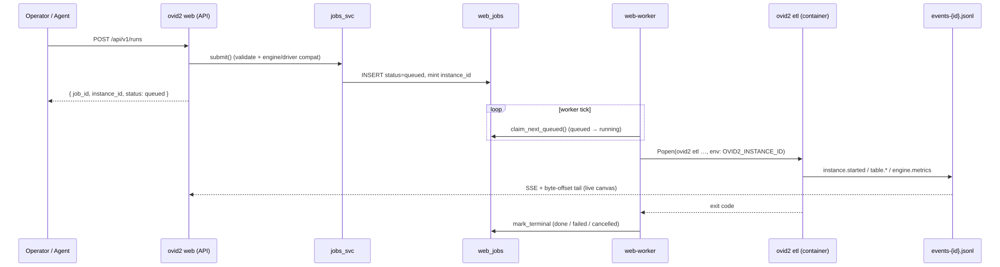

## Three axes, kept independent

The main design goal of Ovid2 is that **storage**, **compute** and
**algorithms** can each change without touching the other two.

| Axis | Abstraction | Examples | Lives in |
| --- | --- | --- | --- |
| Storage | **Driver** (one per storage type) | disc, S3, Azure Blob, GCS, Snowflake, Databricks, Postgres, SQL Server, Access | `src/ovid2/drivers/` |
| Compute | **Engine** + **stager** | PySpark, Databricks Spark, Snowpark, DuckDB | `src/ovid2/core/engines/` |
| Algorithms | **Formatters, mappers, fixers, transforms** | YAML specs and registered ops | `src/ovid2/formatters/`, `mappers/`, `transformations/`, `transforms/` |

Contract tests enforce the boundaries between them. For example:

- only engine modules may import `pyspark`, `snowflake.snowpark` or
  `duckdb`;
- shared algorithm code imports column functions from a portable DSL;
- the ETL engine never imports a specific CDM.

A pipeline written for CSV files on disc therefore runs unchanged against
Snowflake on Snowpark. See [Invariants](../09-developers/invariants.md).

## Three trust tiers

| Tier | Process | May | May not |
| --- | --- | --- | --- |
| **Agent** (untrusted planner) | `ovid2 mcp`, the assistant | call the typed HTTP API; propose actions | import secrets, drivers, connections or pipeline code |
| **API** (trusted gateway) | `ovid2 web` | authorise, audit, queue, and gate on approvals | read a plaintext secret in a request handler |
| **Executor** (least privilege) | `ovid2 etl`, `ovid2 tools …`, containers | dereference the secrets it was granted; touch data | see secrets outside its scope |

Details: [Trust model](trust-model.md).

## The component map

## From submit to output

1. A person (or agent) submits a job through the web panel, the API or MCP.
2. The API validates it, checks that the engine and driver are compatible,
   mints an **instance id** and stores the job as `queued`.
3. The **worker** claims it and starts `ovid2 etl …` (or `health`,
   `tools copy` …) as a subprocess. The subprocess gets an allow-listed
   environment and a private directory holding only the secrets this job
   needs.
4. The executor starts an isolated Docker cluster (or a single DuckDB or
   Snowpark container) and runs the pipeline as one lazy plan per table.
5. Events stream to `events-<instance_id>.jsonl`. The panel tails that file
   for the live canvas.
6. On exit the worker records `done`, `failed` or `cancelled`.

## Triggers

Manual submits, cron and interval schedules, and folder *watches* all
converge on the same `submit()` call and the same queue. See
[Scheduling](../04-running-jobs/scheduling.md).

## Control plane and data plane

Every operation is also classified by **plane**:

| Plane | Covers | Returns row values? |
| --- | --- | --- |
| Control | configuration, metadata, probes, listings, schemas | never |
| Row access | engine-less samples, counts, exports | yes |
| Data plane | engine reads and writes | yes |

The web panel, MCP server, Data Space browsing and overwrite checks are
control-plane code. They can show you that a table exists, how large it is
and what its columns are, without ever loading a row. Anything that returns
row values runs in an executor, and for agents it also requires a human
approval.
