An `etl` job runs these stages **per table**, in this order. Together they
form **one lazy plan**: nothing is computed until the final write, and
nothing is written to intermediate files.

| # | Stage | Configured by | Guarantee |
| --- | --- | --- | --- |
| 1 | **Format** | `formatters/<table>.yaml` | output has exactly the CDM table's columns |
| 2 | **Deduplicate** | the CDM's composite key | no two rows share a key |
| 3 | **Map** | `mappers/<table>.yaml` + `dictionaries.py` | source codes translated to standard values |
| 4 | **Fix** | `fixer_configs.py` | documented corrections applied, each one logged |
| 5 | **Write** | the output address | one write per table, at the exact location |

Pick stages with `--transformations` (CLI) or *Options → Stages*
(web). `all` runs every stage; `format deduplicate` stops before mapping.

## 1 · Format

The formatter reads the source files or tables that match its globs and
builds the target table using one framework **adapter**:

- `source_passthrough` — project and rename columns from same-shaped sources;
- `semantic_join` / `omop_concept_join` — join to a vocabulary such as OMOP
  `CONCEPT`;
- `union_of_specs` — build one table from several sub-specs, e.g. VITAL
  from blood pressure, height and weight;
- `custom` — a hand-written class, for the rare cases the others can't express.

With `output_columns_from: <cdm>.<TABLE>`, the output is validated against
the CDM before anything runs. → [Formatter specs](../06-authoring/formatters.md)

## 2 · Deduplicate

Removes rows that share the table's **composite key**, as declared in the
CDM YAML (for example `PATID` for `DEMOGRAPHIC`). Two safeguards keep
skewed data fast without changing the result:

- **Null-key passthrough.** Rows with a null or empty key part are kept as
  they are; they can't be duplicates.
- **Salted two-stage dedup.** A hot key is spread across
  `OVID2_DEDUP_SALT_BUCKETS` (default 32) partitions on Spark.

## 3 · Map

Mapper ops translate column values: dictionary lookups, vocabulary lookups,
deterministic hashing of identifiers with a per-pipeline salt, case
normalisation, regex replacement, literals, and chains from the transforms
library. → [Mapper specs](../06-authoring/mappers.md)

## 4 · Fix

Each table runs its **fixer chain** in order. Fixers enforce referential
and clinical logic, for example:

- remove diagnoses whose patient doesn't exist (`patid_orphans`);
- null dates in the future (`future_date_to_null`);
- drop records dated after death (`delete_records_after_death`).

Every fixer emits a `fix.applied`, `fix.skipped` or `fix.failed` event. If
a fixer fails, the table keeps its pre-fix data instead of losing rows
silently. → [Fixer chains](../06-authoring/fixers.md) ·
[Fixer catalogue](../10-reference/fixers.md)

## 5 · Write

The output driver writes each table **once** to the exact output address:

- disc gets `<table>.csv` (or Parquet / JSON);
- object stores get `<prefix>/<table>.<fmt>`;
- warehouses get a CDM-typed table (`VARCHAR(n)`, `DATE`, `NUMBER`) in
  `DATABASE.SCHEMA`.

## Reference tables go first

Some fixers look at other tables. For example, orphan removal needs
`DEMOGRAPHIC`, `ENCOUNTER` and `PROVIDER`. The CDM therefore declares
**reference tables**, and Ovid2 finishes those first, in CDM order:

- PCORnet: `demographic`, `provider`, `harvest`, `encounter`, `death`;
- OMOP: `location`, `care_site`, `provider`, `person`, `visit_occurrence`.

The remaining tables then run sequentially (Spark), or several at a time,
largest first (DuckDB).
