## One instance id per run

Every run gets an **instance id**, `YYYYMMDD-HHMMSS-<6hex>`, minted when
the job is submitted. The same id appears everywhere the run goes:

```text
web_jobs row ─► OVID2_INSTANCE_ID ─► containers ovid2-*-<id> ─► network ─►
temp/work/log dirs ─► events-<id>.jsonl ─► /runs/<id> in the panel
```

If you know the instance id, you can trace the run through every log and
every tier.

## Per-invocation isolation

Each run creates and owns:

- its own **compose file** and **Docker bridge network**;
- its own **Spark temp, work and log directories**;
- its own **signal directory** (for cooperative cancel);
- its own **secret scope** and **mount list**: only the folders and
  secrets it needs;
- its own **event log**.

Two runs of the same pipeline can therefore run side by side without
clobbering each other. A start-up sweep removes orphaned instance files
older than six hours.

## The event bus

Pipeline code never prints and never talks to a UI. It emits **typed
events** onto an event bus. Renderers subscribe to the bus, and the
pipeline doesn't know which ones are listening.



| Event | Emitted when |
| --- | --- |
| `instance.started` / `instance.finished` | the run process starts or exits |
| `table.started` / `table.completed` / `table.failed` | one CDM table begins, succeeds or fails |
| `stage.progress` | a stage reports progress |
| `fix.applied` / `fix.skipped` / `fix.failed` | a fixer ran, didn't apply, or raised |
| `batch.*` | scheduler-level batch lifecycle |
| `log`, `warning`, `error` | free-form messages |

Events are one JSON object per line in
`$XDG_RUNTIME_DIR/ovid2/events-<instance_id>.jsonl`, and validate against
`resources/schemas/events.v1.json`.

## Renderers

| Renderer | Where you see it |
| --- | --- |
| web live canvas | `/runs/<instance_id>` — streamed over Server-Sent Events |
| `ovid2 watch` | Rich terminal UI |
| plain log | `--stderr-log`, one line per event |
| JSONL archive | daily files under the archive directory |
| e-mail digest | batch completion e-mails (SMTP settings) |

Developer detail: [Events](../09-developers/events.md).
